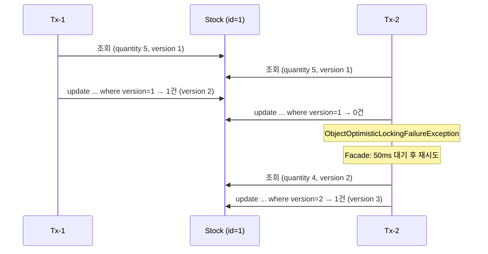

# 재고시스템으로 알아보는 동시성이슈 해결방법 — Optimistic Lock

재고 감소 로직에 동시 요청이 몰릴 때 생기는 Race Condition을 낙관적 락(Optimistic Lock)과 재시도로 해결한다.

- 이 브랜치(`step2-2-db-optimistic-lock`)는 Optimistic Lock 단계까지의 결과물이다. 이후 단계는 `main` 브랜치에서 진행한다.
- 실행 방법·테스트 방식은 [프로젝트 설명](docs/project.md)에 정리했다.
- 강의: [인프런 — 재고시스템으로 알아보는 동시성이슈 해결방법](https://www.inflearn.com/course/%EB%8F%99%EC%8B%9C%EC%84%B1%EC%9D%B4%EC%8A%88-%EC%9E%AC%EA%B3%A0%EC%8B%9C%EC%8A%A4%ED%85%9C/dashboard?cid=328995) / 강의 소스: [sangyongchoi/stock-example](https://github.com/sangyongchoi/stock-example)

## 문제: Race Condition

재고 감소는 `조회 → 감소 → 저장` 순서로 실행된다. 두 트랜잭션이 같은 값을 읽고 각자 저장하면 감소분 하나가 사라진다.
그래서 재고 100개에 100건을 동시에 요청해도 0이 되지 않는다.

## 해결: Optimistic Lock

락을 잡지 않고, **버전 컬럼**으로 갱신 시점에 충돌을 감지한다. 충돌하면 예외가 나므로 **재시도를 직접 구현**한다.

```java
// Stock
@Version
private Long version;

// StockRepository
@Lock(LockModeType.OPTIMISTIC)
@Query("select s from Stock s where s.id = :id")
Stock findByIdWithOptimisticLock(Long id);

// OptimisticLockStockService — 한 번 시도하는 트랜잭션
@Transactional
public void decrease(Long id, Long quantity) {
    Stock stock = stockRepository.findByIdWithOptimisticLock(id);
    stock.decrease(quantity);
    stockRepository.save(stock);
}

// OptimisticLockStockFacade — 실패하면 50ms 쉬고 다시 시도
public void decrease(Long id, Long quantity) throws InterruptedException {
    while (true) {
        try {
            optimisticLockStockService.decrease(id, quantity);
            break;
        } catch (Exception e) {
            Thread.sleep(50);
        }
    }
}
```

실행되는 쿼리:

```sql
update stock set product_id=?, quantity=?, version=? where id=? and version=?
```



- 재시도는 **트랜잭션 바깥(Facade)**에서 한다. 같은 트랜잭션 안에서 다시 조회하면 영속성 컨텍스트의 옛 엔티티(옛 버전)를 받아 계속 실패한다.
- **주의:** Facade가 `catch (Exception e)`로 모든 예외를 재시도한다(강의 코드 그대로). 재고 부족처럼 다시 해도 같은 예외는 무한 반복되므로, 실무라면 `ObjectOptimisticLockingFailureException`만 재시도하고 최대 횟수를 둔다.

### 장단점

| 장점 | 단점 |
|---|---|
| DB 락을 잡지 않아 **충돌이 드물면** 대기 없이 빠르다. | 충돌 시 **재시도 로직을 직접 구현**해야 한다. |
| 락 대기로 커넥션을 붙잡지 않고, 데드락 걱정이 없다. | **충돌이 잦으면** 재시도가 쌓여 Pessimistic Lock보다 느려진다. (이 테스트: 약 5.4초 vs Pessimistic 약 1.4초) |
| DB 버전 컬럼으로 판단하므로 **서버가 여러 대여도 동작**한다. | 버전 컬럼 추가 등 엔티티 변경이 필요하다. |
