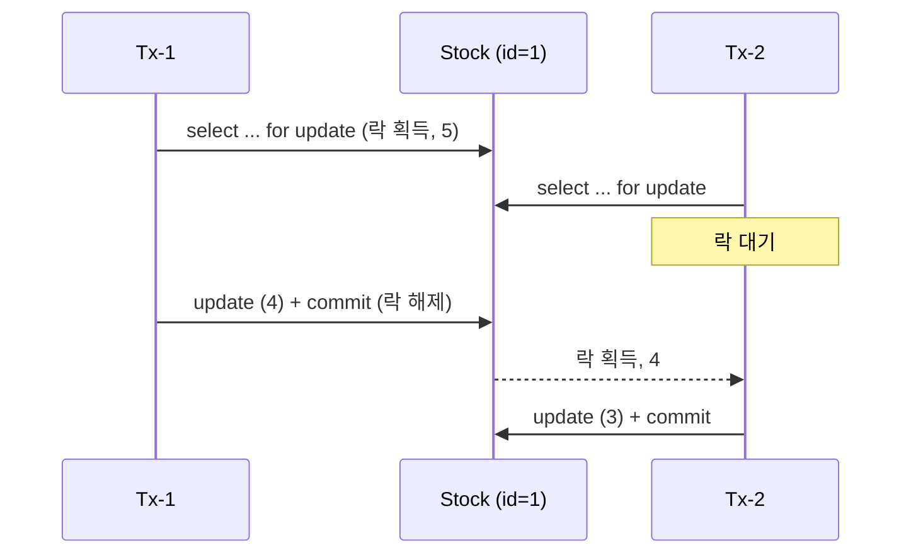

# 재고시스템으로 알아보는 동시성이슈 해결방법 — Pessimistic Lock

재고 감소 로직에 동시 요청이 몰릴 때 생기는 Race Condition을 DB 비관적 락(Pessimistic Lock)으로 해결한다.

- 이 브랜치(`step2-1-db-pessimistic-lock`)는 Pessimistic Lock 단계까지의 결과물이다. 이후 단계는 `main` 브랜치에서 진행한다.
- 실행 방법·테스트 방식은 [프로젝트 설명](docs/project.md)에 정리했다.
- 강의: [인프런 — 재고시스템으로 알아보는 동시성이슈 해결방법](https://www.inflearn.com/course/%EB%8F%99%EC%8B%9C%EC%84%B1%EC%9D%B4%EC%8A%88-%EC%9E%AC%EA%B3%A0%EC%8B%9C%EC%8A%A4%ED%85%9C/dashboard?cid=328995) / 강의 소스: [sangyongchoi/stock-example](https://github.com/sangyongchoi/stock-example)

## 문제: Race Condition

재고 감소는 `조회 → 감소 → 저장` 순서로 실행된다. 두 트랜잭션이 같은 값을 읽고 각자 저장하면 감소분 하나가 사라진다.
그래서 재고 100개에 100건을 동시에 요청해도 0이 되지 않는다.

## 해결: Pessimistic Lock

재고를 조회할 때 DB 행에 **배타 락**(`SELECT ... FOR UPDATE`)을 건다.
락을 잡은 트랜잭션이 커밋할 때까지 다른 트랜잭션은 같은 행을 조회하지 못하고 기다린다.

```java
// StockRepository
@Lock(LockModeType.PESSIMISTIC_WRITE)
@Query("select s from Stock s where s.id = :id")
Stock findByIdWithPessimisticLock(Long id);

// PessimisticLockStockService
@Transactional
public void decrease(Long id, Long quantity) {
    Stock stock = stockRepository.findByIdWithPessimisticLock(id);
    stock.decrease(quantity);
    stockRepository.save(stock);
}
```

실행되는 쿼리:

```sql
select ... from stock stock0_ where stock0_.id=? for update
```



- 락은 트랜잭션이 끝날 때(커밋·롤백) DB가 해제한다. 락 구간이 커밋까지 포함되므로 `synchronized`와 달리 `@Transactional`을 그대로 쓴다.

### 장단점

| 장점 | 단점 |
|---|---|
| 락을 DB가 관리하므로 **서버가 여러 대여도 동작**한다. | 락을 기다리는 동안 트랜잭션과 DB 커넥션을 붙잡고 있어 **처리량이 떨어진다.** |
| 락 단위가 **행**이라 다른 상품의 재고 감소는 막지 않는다. | 여러 행을 서로 다른 순서로 잠그면 **데드락**이 날 수 있다. |
| 충돌이 잦을 때는 Optimistic Lock보다 성능이 나을 수 있다. | 기본 대기 시간이 길다(MySQL `innodb_lock_wait_timeout` 기본 50초). 필요하면 `javax.persistence.lock.timeout` 힌트로 조정한다. |
| 별도 재시도 로직 없이 정합성이 확실하다. | |
