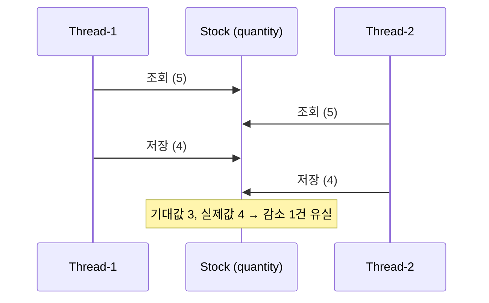

# 재고시스템으로 알아보는 동시성이슈 해결방법 — synchronized

재고 감소 로직에 동시 요청이 몰릴 때 생기는 Race Condition을 Java `synchronized`로 해결한다.

- 이 브랜치(`sync`)는 `synchronized` 단계까지의 결과물이다. 이후 단계(DB 락, Redis 락)는 `main` 브랜치에서 진행한다.
- 실행 방법·테스트 방식은 [프로젝트 설명](docs/project.md)에 정리했다.
- 강의: [인프런 — 재고시스템으로 알아보는 동시성이슈 해결방법](https://www.inflearn.com/course/%EB%8F%99%EC%8B%9C%EC%84%B1%EC%9D%B4%EC%8A%88-%EC%9E%AC%EA%B3%A0%EC%8B%9C%EC%8A%A4%ED%85%9C/dashboard?cid=328995) / 강의 소스: [sangyongchoi/stock-example](https://github.com/sangyongchoi/stock-example)

## 문제: Race Condition

재고 감소는 `조회 → 감소 → 저장` 순서로 실행된다. 두 스레드가 같은 값을 읽고 각자 저장하면 감소분 하나가 사라진다.
그래서 재고 100개에 100건을 동시에 요청해도 0이 되지 않는다(예: `expected: <0> but was: <90>`).



## 해결: `synchronized`

`StockService.decrease()`에 `synchronized`를 붙여 한 번에 한 스레드만 `조회 → 감소 → 저장`을 실행하게 한다.

```java
//    @Transactional
public synchronized void decrease(Long id, Long quantity){
    Stock stock = stockRepository.findById(id).orElseThrow();
    stock.decrease(quantity);

    stockRepository.saveAndFlush(stock);
}
```

### 주의: `@Transactional`을 유지하면 해결되지 않는다

트랜잭션은 Spring 프록시가 메서드 **바깥**에서 시작하고 커밋한다.

```
프록시: 트랜잭션 시작
  └── decrease()   ← synchronized 락 구간
프록시: 커밋         ← 락이 이미 풀린 뒤
```

락이 풀린 뒤 커밋되기 전에 다른 스레드가 들어오면, 커밋되지 않은 이전 수량을 읽어 다시 감소분이 유실된다.
그래서 `@Transactional`을 제거한다. 트랜잭션이 없으면 변경 감지가 동작하지 않으므로 `saveAndFlush`로 직접 저장한다.

### 장단점

| 장점 | 단점 |
|---|---|
| 키워드 하나로 끝날 만큼 **단순**하다. | **JVM 로컬 락**이다. 서버가 2대 이상이면 서로의 락을 모르므로 보장되지 않는다. |
| DB 락·Redis 같은 추가 인프라가 필요 없다. | `@Transactional`을 쓸 수 없어 다른 작업과 하나의 트랜잭션으로 묶을 수 없다. |
| 서버가 1대라면 확실히 직렬화된다. | 락 단위가 빈 인스턴스 전체라, 상품 1의 감소가 상품 2의 감소까지 막는다. |
| | 락 대기 타임아웃이나 공정성을 제어할 수 없다. |
