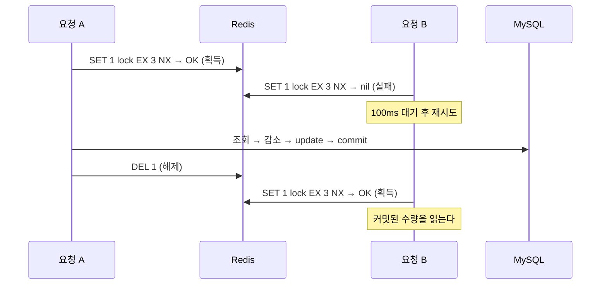

# 재고시스템으로 알아보는 동시성이슈 해결방법 — Redis (Lettuce)

재고 감소 로직에 동시 요청이 몰릴 때 생기는 Race Condition을 Redis `SET NX` 기반 spin lock(Lettuce)으로 해결한다.

- 이 브랜치(`step3-1-redis-lettuce`)는 Lettuce 단계까지의 결과물이다. 이후 단계는 `main` 브랜치에서 진행한다.
- 실행 방법·테스트 방식은 [프로젝트 설명](docs/project.md)에 정리했다.
- 강의: [인프런 — 재고시스템으로 알아보는 동시성이슈 해결방법](https://www.inflearn.com/course/%EB%8F%99%EC%8B%9C%EC%84%B1%EC%9D%B4%EC%8A%88-%EC%9E%AC%EA%B3%A0%EC%8B%9C%EC%8A%A4%ED%85%9C/dashboard?cid=328995) / 강의 소스: [sangyongchoi/stock-example](https://github.com/sangyongchoi/stock-example)

## 문제: Race Condition

재고 감소는 `조회 → 감소 → 저장` 순서로 실행된다. 두 트랜잭션이 같은 값을 읽고 각자 저장하면 감소분 하나가 사라진다.
그래서 재고 100개에 100건을 동시에 요청해도 0이 되지 않는다.

## 해결: Redis 락 (Lettuce)

Redis에 **키가 없을 때만 저장**(`SET NX`)해서, 키를 먼저 만든 요청만 락을 얻는다. 나머지는 100ms 쉬었다가 다시 시도한다(**spin lock**).
Lettuce는 `spring-boot-starter-data-redis`의 기본 Redis 클라이언트로, 코드에 직접 드러나지 않고 `RedisTemplate` 아래에서 명령을 보낸다.

```java
// RedisLockRepository — 키가 없을 때만 저장 (만료 3초)
public Boolean lock(Long key) {
    return redisTemplate
            .opsForValue()
            .setIfAbsent(generateKey(key), "lock", Duration.ofMillis(3_000));
}

public Boolean unlock(Long key) {
    return redisTemplate.delete(generateKey(key));
}

// LettuceLockStockFacade — 락 획득(재시도) → 재고 감소 → 락 해제
public void decrease(Long id, Long quantity) {
    while (!redisLockRepository.lock(id)) {
        try {
            Thread.sleep(100);
        } catch (InterruptedException e) {
            Thread.currentThread().interrupt();
            throw new IllegalStateException("락 대기 중 인터럽트가 발생했습니다. id=" + id, e);
        }
    }

    try {
        redisLockStockService.decrease(id, quantity);
    } finally {
        redisLockRepository.unlock(id);
    }
}

// RedisLockStockService — synchronized 없이 트랜잭션만
@Transactional
public void decrease(Long id, Long quantity) {
    Stock stock = stockRepository.findById(id).orElseThrow();
    stock.decrease(quantity);
    stockRepository.save(stock);
}
```



- 만료 시간을 함께 넘기면 `SETNX` + `EXPIRE` 두 명령이 아니라 `SET ... NX EX` **한 명령**으로 나간다(`redis-cli monitor`로 확인). 그래서 락 획득과 만료 설정이 원자적이다.
- 만료가 있으므로 락을 잡은 서버가 죽어 해제하지 못해도 3초 뒤 풀린다.

### 특이점: Redis 락 전용 서비스를 따로 둔다

- `StockService.decrease`는 `synchronized`라서, 이를 호출하면 Redis 락이 없어도 JVM 안에서 이미 한 줄로 실행돼 **테스트가 통과해 버린다**. Redis 락을 검증할 수 없다.
- 그래서 `synchronized` 없이 `@Transactional`만 붙인 `RedisLockStockService`를 만들었다. 동시 요청을 막는 것은 Redis 락뿐이다.
- 서비스가 반환될 때 커밋되고, 그 뒤 Facade의 `finally`에서 락을 해제하므로 락 범위가 커밋을 감싼다.

### 주의: 락 소유자를 확인하지 않는다

- `unlock`은 값을 확인하지 않고 `DEL`만 한다. 처리가 만료 시간(3초)을 넘기면 A의 락이 만료된 사이 B가 락을 얻고, A가 끝나며 **B의 락을 지울** 수 있다.
- 제대로 하려면 값에 소유자 식별값(UUID 등)을 넣고, "값이 내 것일 때만 삭제"를 Lua 스크립트로 원자적으로 실행해야 한다. Redisson은 이 처리와 만료 연장(watchdog)을 기본으로 제공한다.

### 장단점

| 장점 | 단점 |
|---|---|
| `spring-boot-starter-data-redis`만 있으면 되고 **구현이 간단**하다. | 락을 얻을 때까지 계속 요청하는 spin lock이라 **Redis에 부하**를 준다(100건에 `SET` 875번). |
| 락 대기에 **DB 커넥션을 쓰지 않는다**(Named Lock과의 차이). | 재시도 간격·만료 시간·소유자 확인 등을 **직접 구현**해야 한다. |
| 여러 서버가 같은 Redis를 보므로 **분산 환경에서도 동작**한다. | 재시도 간격만큼 대기가 생겨 느리다(이 테스트에서 약 4.7초). |
