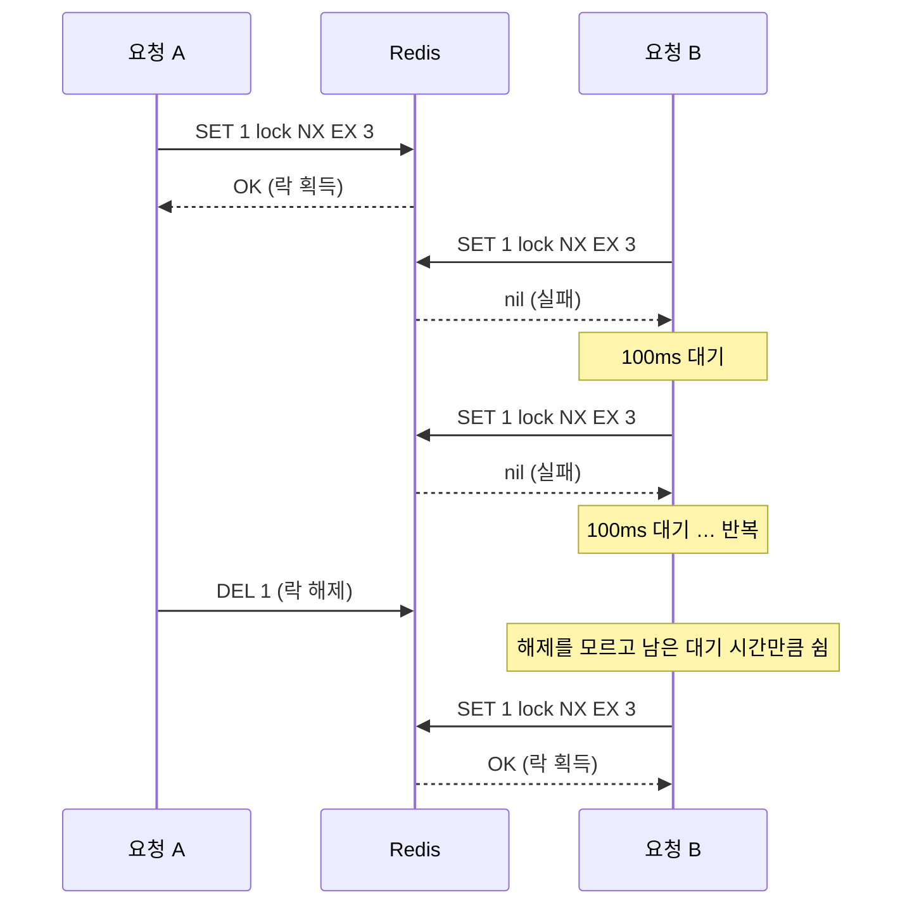
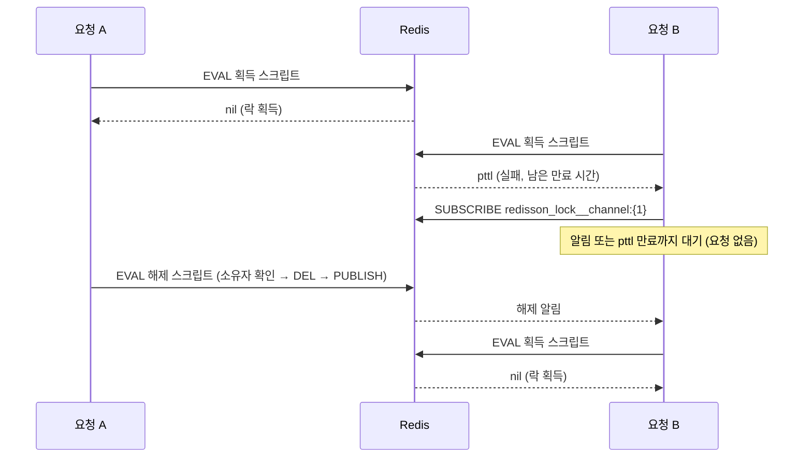

# 재고시스템으로 알아보는 동시성이슈 해결방법 — Redis (Redisson)

재고 감소 로직에 동시 요청이 몰릴 때 생기는 Race Condition을 Redisson의 pub/sub 기반 락(`RLock`)으로 해결한다.

- 이 브랜치(`step3-2-redis-redisson`)는 Redisson 단계까지의 결과물이다.
- 실행 방법·테스트 방식은 [프로젝트 설명](docs/project.md)에 정리했다.
- 강의: [인프런 — 재고시스템으로 알아보는 동시성이슈 해결방법](https://www.inflearn.com/course/%EB%8F%99%EC%8B%9C%EC%84%B1%EC%9D%B4%EC%8A%88-%EC%9E%AC%EA%B3%A0%EC%8B%9C%EC%8A%A4%ED%85%9C/dashboard?cid=328995) / 강의 소스: [sangyongchoi/stock-example](https://github.com/sangyongchoi/stock-example)

## 문제: Race Condition

재고 감소는 `조회 → 감소 → 저장` 순서로 실행된다. 두 트랜잭션이 같은 값을 읽고 각자 저장하면 감소분 하나가 사라진다.
그래서 재고 100개에 100건을 동시에 요청해도 0이 되지 않는다.

## 해결: Redis 락 (Redisson)

`RLock.tryLock(대기 시간, 점유 시간)`으로 락을 얻는다. 락을 얻지 못한 요청은 Redis를 반복해서 두드리지 않고,
**락 해제 알림(pub/sub)을 구독한 채 기다렸다가** 알림이 오면 다시 시도한다.

```java
// RedissonLockStockFacade — 최대 10초 대기, 획득 후 1초 점유 → 재고 감소 → 락 해제
public void decrease(Long id, Long quantity) {
    RLock lock = redissonClient.getLock(id.toString());

    boolean available;
    try {
        available = lock.tryLock(10, 1, TimeUnit.SECONDS);
    } catch (InterruptedException e) {
        Thread.currentThread().interrupt();
        throw new IllegalStateException("락 대기 중 인터럽트가 발생했습니다. id=" + id, e);
    }

    if (!available) {
        throw new IllegalStateException("락 획득에 실패했습니다. id=" + id);
    }

    // 락을 얻은 경우에만 해제한다
    try {
        redisLockStockService.decrease(id, quantity);
    } finally {
        lock.unlock();
    }
}

// RedisLockStockService — synchronized 없이 트랜잭션만
@Transactional
public void decrease(Long id, Long quantity) {
    Stock stock = stockRepository.findById(id).orElseThrow();
    stock.decrease(quantity);
    stockRepository.save(stock);
}
```

`redis-cli monitor`로 확인한 실제 동작:

- 락은 **Hash**다. 필드가 `클라이언트 UUID:스레드 ID`, 값이 획득 횟수라서 **소유자 확인**과 **재진입**이 된다.
- 획득·해제가 모두 **Lua 스크립트(`EVAL`) 한 번**으로 원자적으로 실행된다. 해제 스크립트는 "내 락일 때만" 지우고 바로 `publish`한다.
- 획득에 실패하면 남은 만료 시간(`pttl`)을 돌려받고, `redisson_lock__channel:{id}` 채널을 구독한 채 알림이나 만료를 기다린다.

## Lettuce(spin lock)와 Redisson(pub/sub) 비교

### Lettuce — spin lock 재시도

락을 얻을 때까지 `SET NX`를 일정 간격(100ms)으로 계속 보낸다. 락이 언제 풀릴지 모르니 직접 물어보는 방식이다.



- 대기하는 요청 수 × (대기 시간 / 재시도 간격)만큼 Redis에 요청이 쌓인다.
- 간격을 줄이면 Redis 부하가 커지고, 늘리면 락이 풀린 뒤에도 놀고 있는 시간이 길어진다.

### Redisson — pub/sub

락을 얻지 못하면 해제 알림 채널을 구독하고 기다린다. 락을 가진 쪽이 해제하면서 `publish`하고, 알림을 받은 요청만 다시 시도한다.



- 기다리는 동안 Redis에 요청을 보내지 않으므로 대기 요청이 많아도 Redis 부하가 거의 늘지 않는다.
- 해제되는 즉시 알림을 받으므로 재시도 간격만큼 노는 시간이 없다.

| 구분 | Lettuce (spin lock) | Redisson (pub/sub) |
|---|---|---|
| 대기 방식 | 일정 간격으로 `SET NX` 재요청 | 해제 알림 채널 구독 후 대기 |
| Redis 부하 | 대기 요청이 많을수록 큼 (100건에 `SET` 875번) | 작음 (100건에 획득 시도 244번) |
| 락이 풀린 뒤 반응 | 재시도 간격만큼 늦음 (이 테스트에서 약 4.7초) | 알림을 받고 바로 재시도 (약 1.3초) |
| 소유자 확인 | 직접 구현해야 함 (강의 코드는 없음) | 기본 제공 (`UUID:스레드 ID`) |
| 재진입 | 안 됨 | 됨 (획득 횟수 카운트) |
| 만료 연장 | 직접 구현해야 함 | watchdog 제공 (leaseTime을 지정하지 않을 때) |
| 의존성 | `spring-boot-starter-data-redis`만 | Redisson 라이브러리 추가 |
| 구현 난이도 | 로직을 직접 짜야 하지만 원리가 단순 | 코드는 짧지만 라이브러리 동작을 알아야 함 |

## 특이점

### Redisson 버전을 Boot 2.7에 맞춘다 (`3.18.0`)

- starter는 버전마다 Spring Data Redis 연동 모듈을 하나 골라 가져온다. `3.23.2`는 Boot 3용 `redisson-spring-data-31`을 가져와
  Spring Data Redis 2.7인 이 프로젝트에서 `NoClassDefFoundError: ...RedissonConnection`이 났다.
- `3.17.3 ~ 3.18.0`이 Boot 2.7용 `redisson-spring-data-27`을 가져오므로 그중 마지막인 `3.18.0`을 쓴다.

### Redisson starter를 넣으면 `RedisTemplate`도 Redisson으로 연결된다 → `RedisConfig`로 Lettuce 유지

- Redisson 자동 설정이 Spring Boot의 Redis 자동 설정보다 먼저 `RedissonConnectionFactory`를 등록하므로, `RedisTemplate`(Lettuce 단계)이 Redisson 클라이언트로 명령을 보내게 된다.
- 코드와 보내는 명령(`SET NX`, `DEL`)은 그대로이고 **명령을 보내는 클라이언트만** 바뀐다. pub/sub 대기 같은 Redisson 락 기능은 `RLock`을 써야만 동작한다.
- Lettuce 단계가 이름대로 Lettuce를 쓰도록 `RedisConfig`에서 `LettuceConnectionFactory`를 직접 등록했다. `RedissonClient`는 그대로 Redisson이 만든다.

### 강의 소스와 다른 점

- `StockService`(`synchronized`) 대신 `RedisLockStockService`를 쓴다. `synchronized` 서비스를 호출하면 Redisson 락 없이도 테스트가 통과해 검증이 되지 않는다.
- 락을 얻지 못했을 때 `finally`에서 `unlock()`하면 `IllegalMonitorStateException`이 나므로, **락을 얻은 뒤에만** 해제한다.
- 획득 실패 시 조용히 `return`하지 않고 예외를 던져 테스트에서 드러나게 했다.

### 주의: leaseTime을 지정하면 watchdog이 꺼진다

- `tryLock(10, 1, SECONDS)`는 1초 뒤 락이 자동으로 풀린다. 처리가 1초를 넘으면 끝나기 전에 다른 요청이 락을 얻는다.
- leaseTime을 생략하면 watchdog이 기본 30초 만료를 처리 중에 계속 연장하고, 서버가 죽으면 연장이 멈춰 만료된다.

## 장단점

| 장점 | 단점 |
|---|---|
| pub/sub으로 대기하므로 spin lock보다 **Redis 부하가 적다**. | 별도 라이브러리가 필요하고, Spring Boot 버전에 맞는 버전을 골라야 한다. |
| 해제 알림을 받아 바로 재시도하므로 **대기 지연이 짧다**(이 테스트에서 약 1.3초). | starter 자동 설정이 `RedisTemplate` 연결까지 바꾸는 등 **라이브러리 동작을 이해**해야 한다. |
| 소유자 확인·재진입·만료 연장을 **라이브러리가 제공**한다. | leaseTime을 처리 시간보다 짧게 잡는 등 옵션을 잘못 쓰면 정합성이 깨진다. |
| 락을 Redis가 맡아 DB 커넥션을 쓰지 않고, **분산 환경에서도 동작**한다. | |
