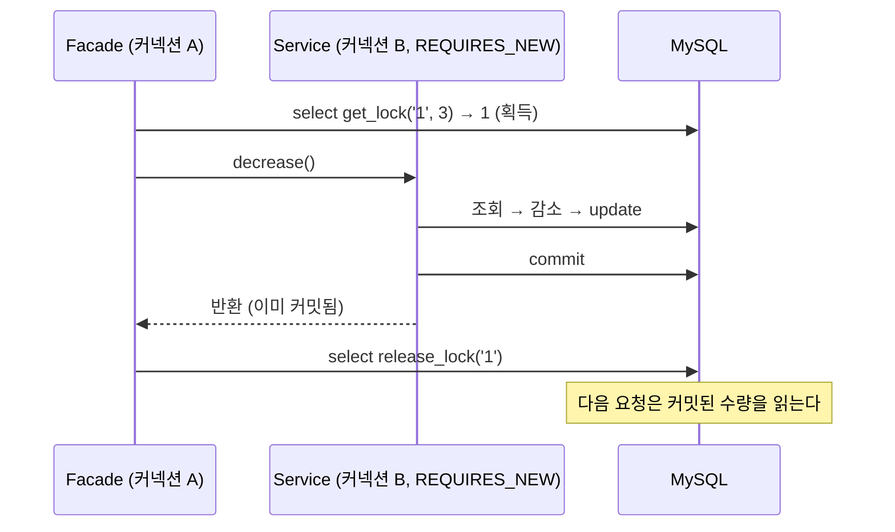

# 재고시스템으로 알아보는 동시성이슈 해결방법 — Named Lock

재고 감소 로직에 동시 요청이 몰릴 때 생기는 Race Condition을 MySQL Named Lock(`GET_LOCK` / `RELEASE_LOCK`)으로 해결한다.

- 이 브랜치(`step2-3-db-named-lock`)는 Named Lock 단계까지의 결과물이다. 이후 단계는 `main` 브랜치에서 진행한다.
- 실행 방법·테스트 방식은 [프로젝트 설명](docs/project.md)에 정리했다.
- 강의: [인프런 — 재고시스템으로 알아보는 동시성이슈 해결방법](https://www.inflearn.com/course/%EB%8F%99%EC%8B%9C%EC%84%B1%EC%9D%B4%EC%8A%88-%EC%9E%AC%EA%B3%A0%EC%8B%9C%EC%8A%A4%ED%85%9C/dashboard?cid=328995) / 강의 소스: [sangyongchoi/stock-example](https://github.com/sangyongchoi/stock-example)

## 문제: Race Condition

재고 감소는 `조회 → 감소 → 저장` 순서로 실행된다. 두 트랜잭션이 같은 값을 읽고 각자 저장하면 감소분 하나가 사라진다.
그래서 재고 100개에 100건을 동시에 요청해도 0이 되지 않는다.

## 해결: Named Lock

행이 아니라 **이름(문자열)에 락**을 건다. 여기서는 재고 id를 이름으로 쓴다.

```java
// LockRepository (timeout은 초 단위, 반환값 1: 획득, 0: 타임아웃, null: 오류)
@Query(value = "select get_lock(:key, 3)", nativeQuery = true)
Long getLock(String key);

@Query(value = "select release_lock(:key)", nativeQuery = true)
Long releaseLock(String key);

// NamedLockStockFacade — 커넥션 A
@Transactional
public void decrease(Long id, Long quantity) {
    String key = id.toString();

    Long acquired = lockRepository.getLock(key);
    if (acquired == null || acquired != 1L) {
        throw new IllegalStateException("락 획득에 실패했습니다. key=" + key);
    }

    try {
        namedLockStockService.decrease(id, quantity);
    } finally {
        lockRepository.releaseLock(key);
    }
}

// NamedLockStockService — 커넥션 B
@Transactional(propagation = Propagation.REQUIRES_NEW)
public void decrease(Long id, Long quantity) {
    Stock stock = stockRepository.findById(id).orElseThrow();
    stock.decrease(quantity);
    stockRepository.save(stock);
}
```



### 특이점 1: `REQUIRES_NEW`로 트랜잭션 분리

- `GET_LOCK`은 **커넥션(세션) 단위** 락이라 획득과 해제가 같은 커넥션에서 실행돼야 한다. 그래서 Facade에 `@Transactional`을 붙여 커넥션 A를 고정한다.
- 재고 감소가 Facade 트랜잭션에 합류하면, 커밋(Facade 종료 시)보다 `finally`의 락 해제가 먼저 실행된다. 그 사이에 다른 요청이 커밋 전 수량을 읽는다(`synchronized` + `@Transactional`과 같은 문제).
- `REQUIRES_NEW`로 별도 트랜잭션(커넥션 B)을 만들면 서비스가 반환될 때 이미 커밋되어 있으므로, 락 해제 후에는 항상 반영된 값을 읽는다.

### 특이점 2: 커넥션 풀 크기 조정

- 요청 1건이 커넥션을 **2개**(A: 락, B: 재고 감소) 쓰고, 락을 기다리는 요청도 커넥션 A를 붙잡은 채 대기한다.
- 풀이 작으면(기본 10) 대기 요청이 커넥션을 모두 차지해, 락을 잡은 요청이 커넥션 B를 받지 못하고 멈춘다.
- 그래서 `spring.datasource.hikari.maximum-pool-size: 40`으로 늘렸다. 실무에서는 락 전용 `DataSource`를 따로 두는 것을 권장한다.

### 강의 코드와 다른 점 (락 획득)

- **타임아웃:** `get_lock`의 두 번째 인자는 **초 단위**라 강의의 `3000`은 50분이다. `3`(3초)으로 맞췄다.
- **반환값 확인:** 강의는 반환값을 `void`로 버려, 타임아웃으로 락을 못 얻어도 재고를 감소시킨다. `Long`으로 받아 `1`이 아니면 예외를 던진다.
- **획득 위치:** 획득을 `try` 바깥으로 옮겨, 잡지 않은 락을 `finally`에서 해제하지 않게 했다.

### 장단점

| 장점 | 단점 |
|---|---|
| 행이 아닌 **임의의 이름**에 락을 걸 수 있다(잠글 행이 없는 중복 생성·배치 중복 실행 방지에도 사용). | 트랜잭션이 끝나도 자동으로 풀리지 않아 **직접 해제**해야 한다. |
| 추가 인프라 없이 **DB만으로 분산 락**을 구현할 수 있다. | 요청당 커넥션 2개를 써서 **커넥션 풀 고갈** 위험이 있다. |
| 락 대기 타임아웃을 직접 지정할 수 있다. | 트랜잭션 분리 등 구현이 복잡하고, DB마다 문법이 달라 **DB에 종속**된다. |

## DB별 Named Lock 사용법

| DB | 락 획득 | 해제 | 락 범위 |
|---|---|---|---|
| MySQL | `SELECT GET_LOCK('name', 초)` | `SELECT RELEASE_LOCK('name')` | 세션 |
| PostgreSQL | `SELECT pg_advisory_lock(key)` | `SELECT pg_advisory_unlock(key)` | 세션 |
| | `SELECT pg_advisory_xact_lock(key)` | 커밋·롤백 시 **자동 해제** | 트랜잭션 |
| Oracle | `DBMS_LOCK.REQUEST(handle, DBMS_LOCK.X_MODE, 초, release_on_commit)` | `DBMS_LOCK.RELEASE(handle)` | 세션 또는 트랜잭션 |
| SQL Server | `EXEC sp_getapplock @Resource='name', @LockMode='Exclusive'` | `EXEC sp_releaseapplock @Resource='name'` | 세션 또는 트랜잭션 |

- **PostgreSQL:** 키가 문자열이 아닌 `bigint`이므로 `pg_advisory_xact_lock(hashtext('stock:1'))`처럼 해시해서 넘긴다. 트랜잭션 범위 락(`xact`)을 쓰면 자동 해제되어, 이 브랜치의 `REQUIRES_NEW`·커넥션 분리가 필요 없다.
- **Oracle:** 이름을 먼저 `DBMS_LOCK.ALLOCATE_UNIQUE('name', handle)`로 핸들로 바꿔야 하고(내부에서 COMMIT 함), `DBMS_LOCK` 실행 권한이 필요하다.
- **DB 무관:** 락 전용 테이블의 행을 `SELECT ... FOR UPDATE`로 잠그거나, Spring Integration `JdbcLockRegistry`·ShedLock 같은 라이브러리를 쓴다.
