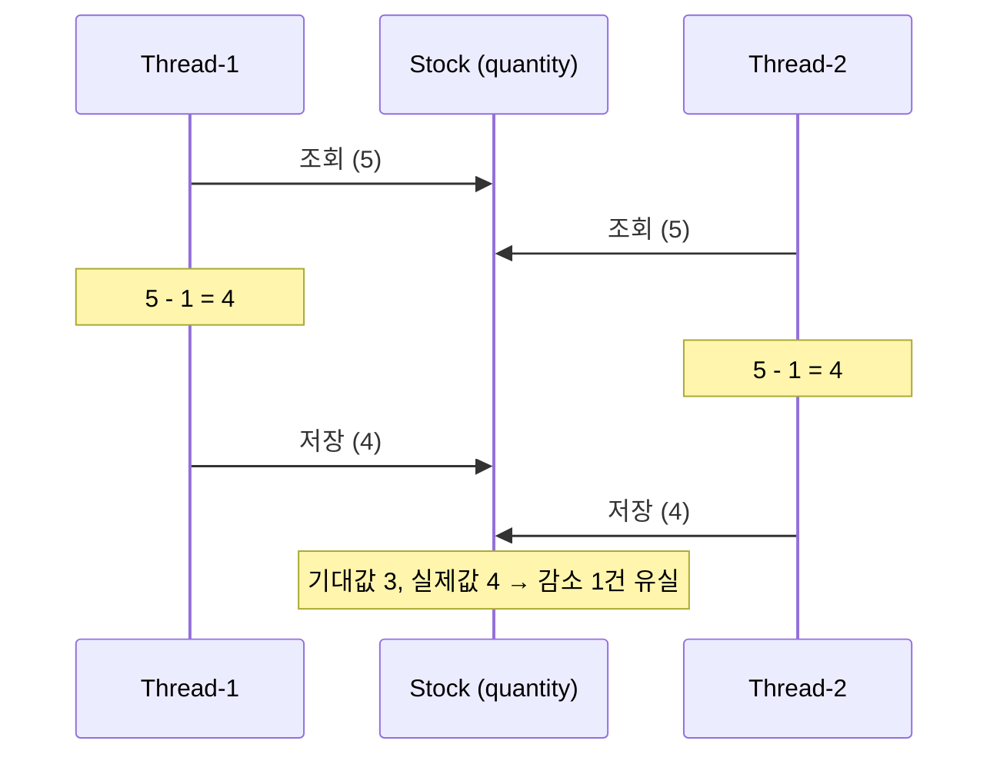

# 재고시스템으로 알아보는 동시성이슈 해결방법

재고(stock)를 감소시키는 단순한 로직에 여러 요청이 동시에 들어오면 재고가 어떻게 어긋나는지 확인하고,
Java·Database·Redis를 이용한 동시성 제어 방법을 차례로 구현하며 비교한다.

- 프로젝트 목적·요구사항·기술 스펙·구조·실행 방법·구현 상세는 [프로젝트 설명](docs/project.md)에 정리했다.
- 강의: [인프런 — 재고시스템으로 알아보는 동시성이슈 해결방법](https://www.inflearn.com/course/%EB%8F%99%EC%8B%9C%EC%84%B1%EC%9D%B4%EC%8A%88-%EC%9E%AC%EA%B3%A0%EC%8B%9C%EC%8A%A4%ED%85%9C/dashboard?cid=328995)
- 강의 소스: [sangyongchoi/stock-example](https://github.com/sangyongchoi/stock-example)

## 동시성 이슈란 (Race Condition)

- 둘 이상의 스레드가 **공유 데이터(재고)에 동시에 접근해 변경**하려 할 때 발생한다.
- 재고 감소는 `조회 → 감소 → 저장` 세 단계로 이루어지는데, 한 스레드의 저장이 끝나기 전에 다른 스레드가 조회하면
  두 스레드가 같은 값을 읽고 각각 1씩 빼서 저장하므로 **감소가 한 번 사라진다(갱신 손실)**.
- 그래서 재고 100개에 100건을 동시에 요청해도 재고가 0이 되지 않는다.

해결의 핵심은 **한 번에 하나의 스레드만 `조회 → 감소 → 저장` 구간에 들어가도록** 하는 것이다.

## 해결 방법 비교

| 방법 | 방식 | 장점 | 단점 / 주의점 |
|---|---|---|---|
| `synchronized` | Java 언어 수준의 락 | 구현이 가장 간단 | 한 프로세스 안에서만 보장 → **서버가 2대 이상이면 무용**. `@Transactional`과 함께 쓰면 커밋 전에 락이 풀려 여전히 깨진다. |
| Pessimistic Lock | DB 행에 배타 락 (`SELECT ... FOR UPDATE`) | 충돌이 잦을 때 Optimistic보다 성능이 나을 수 있고, 정합성이 확실함 | 락 대기로 인한 성능 저하, 데드락 주의 |
| Optimistic Lock | `@Version` 컬럼으로 갱신 시 충돌 감지 | 별도 락을 잡지 않아 충돌이 적으면 빠름 | 충돌 시 **재시도 로직을 직접 구현**해야 함, 충돌이 잦으면 오히려 느림 |
| Named Lock | MySQL `GET_LOCK` / `RELEASE_LOCK` (이름 기반 락) | 행이 아닌 임의의 이름에 락 → 분산 락 용도로 활용 가능 | 트랜잭션 종료 시 자동 해제되지 않아 **직접 해제**해야 함, 락 전용 커넥션 분리 권장 |
| Redis — Lettuce | `SETNX` 기반 spin lock | 구현이 간단, 기본 Redis 클라이언트 | 락을 얻을 때까지 계속 재요청 → **Redis 부하** |
| Redis — Redisson | pub/sub 기반 락 | 락 해제 시 알림을 받아 재시도 → Redis 부하가 적음, 락 획득 재시도·타임아웃 기본 제공 | 별도 라이브러리 필요, 사용법을 익혀야 함 |

## 진행 상황

| 단계 | 내용 | 상태 |
|---|---|---|
| 1 | 재고 감소 로직 작성 + 동시 요청 테스트로 Race Condition 확인 | 완료 |
| 2 | `synchronized`로 해결과 한계 확인 | 예정 |
| 3 | Pessimistic Lock | 예정 |
| 4 | Optimistic Lock (+ 재시도 Facade) | 예정 |
| 5 | Named Lock | 예정 |
| 6 | Redis — Lettuce | 예정 |
| 7 | Redis — Redisson | 예정 |

각 단계를 구현하면 상태를 갱신하고, 구현 상세는 [프로젝트 설명](docs/project.md#구현-상세)에 기록한다.
