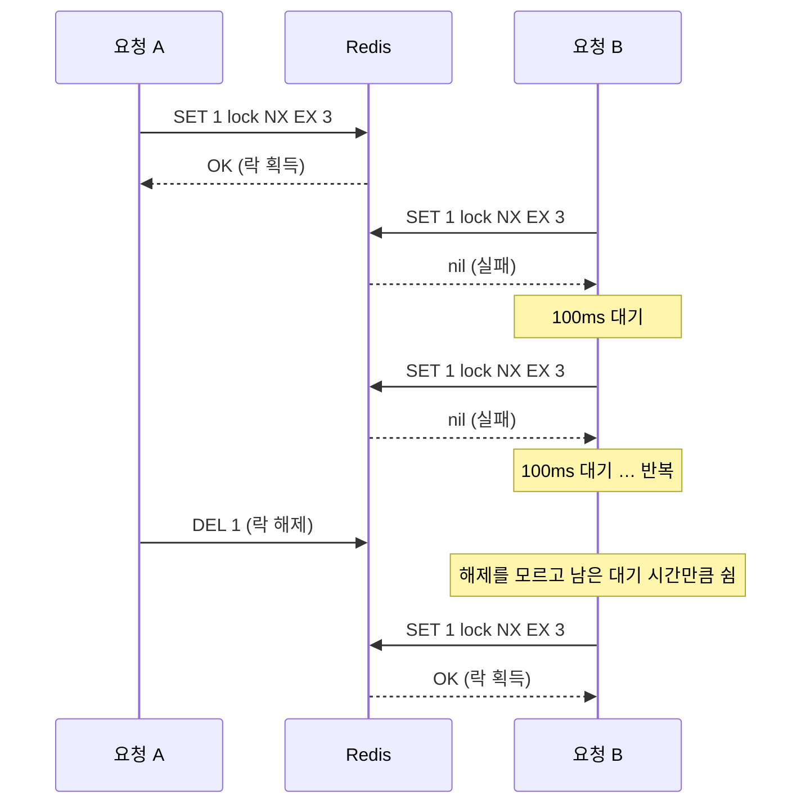
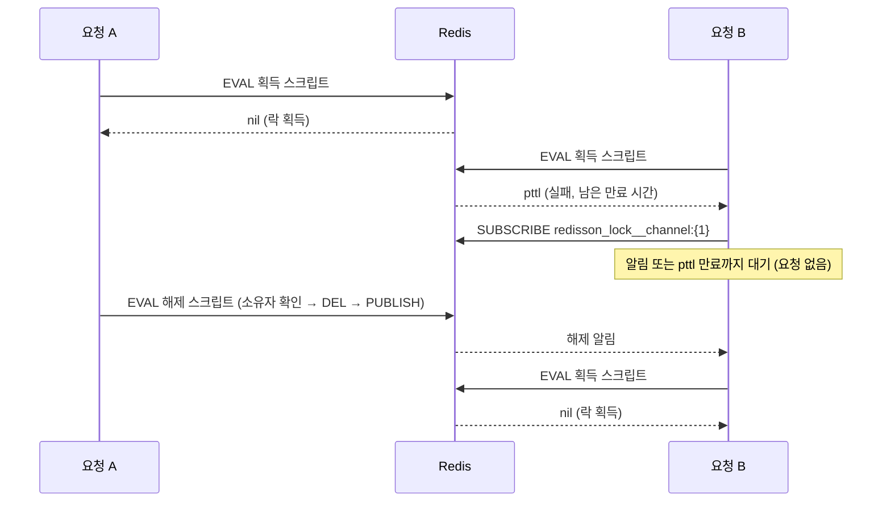

# 프로젝트 설명 — 재고시스템으로 알아보는 동시성이슈 해결방법

> [README](../README.md)로 돌아가기

## 목적

재고 감소처럼 **공유 데이터를 조회 후 변경하는 로직**에 동시 요청이 몰리면 데이터 정합성이 어떻게 깨지는지 확인하고,
이를 해결하는 **동시성 제어 기법**을 직접 구현하며 각각의 특징과 한계를 비교한다.

- 재고 감소 로직 구현 → 동시 요청 테스트로 Race Condition 확인
- Java `synchronized` 적용과 한계 확인
- Database(MySQL) 락 적용: Pessimistic Lock, Optimistic Lock, Named Lock
- Redis 분산 락 적용: Lettuce(spin lock), Redisson(pub/sub)

## 기능

- 상품별 재고 저장
- 재고 감소 (요청 수량만큼 차감)

## 주요 요구사항

- 재고는 **0 미만으로 내려갈 수 없다.** (부족하면 예외)
- 동시에 여러 요청이 들어와도 **요청한 만큼 정확히 차감**되어야 한다.
  (재고 100개에 1개씩 100건을 동시에 요청하면 재고는 0이 되어야 한다.)

## 기술 스펙

| 구분 | 사용 기술 |
|---|---|
| Language | Java 11 |
| Framework | Spring Boot 2.7 (Spring Web, Spring Data JPA) |
| Database | MySQL (Docker) |
| Lock | Redis — Lettuce(Spring Data Redis), Redisson |
| Build | Gradle |
| 기타 | Lombok |

## 프로젝트 구조

강의 소스 기준으로 만들어 갈 구조이며, 구현하면서 갱신한다. 테스트는 방법(서비스·Facade)마다 `XxxTest` 클래스를 따로 둔다.

```
stock-concurrency
└── src
    ├── main/java/com/example/stock
    │   ├── StockApplication
    │   ├── config        # RedisConfig(RedisTemplate이 Lettuce로 연결하도록 연결 팩토리 등록)
    │   ├── domain        # Stock(productId, quantity, @Version) — decrease()에서 수량 검증
    │   ├── repository    # StockRepository(비관적 락·낙관적 락 조회), LockRepository(Named Lock), RedisLockRepository(Lettuce)
    │   ├── service       # StockService(synchronized), PessimisticLockStockService, OptimisticLockStockService, NamedLockStockService, RedisLockStockService
    │   └── facade        # OptimisticLockStockFacade(재시도), NamedLockStockFacade, LettuceLockStockFacade, RedissonLockStockFacade
    └── test/java/com/example/stock
        └── ...           # 방법별 동시 요청 테스트 (100 스레드 → 재고 0 검증)
```

## 실행 방법

### 1. MySQL 실행

```bash
docker run -d -p 3306:3306 -e MYSQL_ROOT_PASSWORD=1234 --name mysql mysql
docker exec -it mysql mysql -uroot -p1234 -e "CREATE DATABASE stock_example;"
```

### 2. Redis 실행 (3단계부터)

```bash
sudo apt install redis-server        # 최초 1회
sudo systemctl start redis-server
redis-cli ping                       # PONG 이면 정상
```

### 3. 설정 파일 생성

`application.yaml`은 Git에서 관리하지 않는다(`.gitignore`, 로컬 전용).
Git에는 DB 접속 정보(url·username·password)를 비워 둔 `application.yaml.example`만 올라가 있으므로, 복사한 뒤 접속 정보를 채운다.

```bash
cp src/main/resources/application.yaml.example \
   src/main/resources/application.yaml
# url: jdbc:mysql://127.0.0.1:3306/stock_example, username, password 입력
```

- `spring.jpa.hibernate.ddl-auto: create` — 기동할 때마다 테이블을 새로 만든다.
- `spring.datasource.hikari.maximum-pool-size: 40` — Named Lock은 요청 1건이 커넥션 2개를 쓰므로 기본값(10)보다 늘려 둔다. example 파일에 이미 들어 있다.

### 4. 테스트 실행

```bash
./gradlew test
```

> 테스트는 실제 MySQL(·Redis)에 붙는 `@SpringBootTest`이므로 위 1~3번이 먼저 되어 있어야 한다.

## 동시성 테스트 방식

모든 방법을 같은 조건으로 검증한다.

- `@BeforeEach`: 재고 100개짜리 상품을 저장하고 그 `id`를 `stockId`에 보관 / `@AfterEach`: 전체 삭제
- 스레드 32개짜리 `ExecutorService` 위에서 `CompletableFuture.runAsync`로 재고 1개 감소 요청 100건을 동시에 보내고, `allOf(...).orTimeout(10초).join()`으로 모두 끝날 때까지 기다린다.
- 남은 재고가 **0**인지 확인한다. (동시성 제어가 없으면 0보다 큰 값이 남아 실패한다.)

## 구현 상세

각 단계를 구현하면서 아래에 정리한다. 강의 소스와 다르게 구현한 부분은 차이점과 이유를 함께 적는다.

### 0. 재고 감소 로직과 Race Condition

- `Stock.decrease()`: 남는 수량이 0 미만이면 예외를 던지고, 아니면 수량을 차감한다.
- `StockService.decrease()`: `@Transactional` 안에서 `findById` → `decrease` → `saveAndFlush`.
  트랜잭션 안에서는 변경 감지로 UPDATE가 나가므로 `saveAndFlush`가 꼭 필요하지는 않다.
  다만 다음 단계(`synchronized`)에서 `@Transactional`을 떼면 엔티티가 준영속 상태가 되어 `save`가 필요해지므로 강의처럼 남겨 둔다.
- 결과: `재고감소`(단건)는 통과하고, `동시에_100개의_요청`은 **실패**한다(예: `expected: <0> but was: <90>`).
  동시성 제어가 없어 여러 스레드가 같은 수량을 읽고 각자 저장하면서 감소분이 유실된다. 남는 값은 실행할 때마다 다르다.

**강의 소스와 다른 점 (테스트)**

| 항목 | 강의 | 이 프로젝트 | 이유 |
|---|---|---|---|
| 조회 id | `findById(1L)` 고정 | `@BeforeEach`에서 저장한 `stockId` | `deleteAll()`은 AUTO_INCREMENT를 초기화하지 않아, 클래스 전체를 실행하면 두 번째 테스트부터 id가 2 이상이 된다. |
| 동시 실행 | `ExecutorService` + `CountDownLatch` | `CompletableFuture.runAsync(..., executorService)` + `allOf().join()` | 더 간결하고, 스레드 안의 예외가 `join()`에서 드러난다. (`submit()`은 예외를 `Future`에 담아 두고 아무도 꺼내지 않으므로 묻힌다.) |
| 대기 제한 | 없음 (`latch.await()`) | `orTimeout(10, SECONDS)` + `finally`에서 `shutdown()` | 락 구현 버그로 데드락이 나도 테스트가 무한정 멈추지 않게 한다. |

> `runAsync`에 풀을 넘기지 않으면 공용 ForkJoinPool(동시 실행 수 = CPU 코어 수 − 1)을 쓰게 되어 경합이 약해지므로 반드시 넘긴다.

### 1. Java — `synchronized`

`StockService.decrease()`에 `synchronized`를 붙여 한 번에 한 스레드만 `조회 → 감소 → 저장`을 실행하게 한다.
`@Transactional`은 제거하고(주석 처리), `saveAndFlush`로 변경을 직접 반영한다.

**주의: `@Transactional`을 유지하면 `synchronized`를 붙여도 해결되지 않는다**

`@Transactional`은 Spring이 만든 프록시가 메서드 **바깥**에서 트랜잭션을 시작하고 커밋한다.

```
프록시: 트랜잭션 시작
  └── StockService.decrease()   ← synchronized 락 구간 (락 획득 ~ 해제)
프록시: 커밋                      ← 락이 이미 풀린 뒤
```

락이 풀린 뒤 커밋되기 전 사이에 다른 스레드가 `decrease()`에 들어오면, 아직 커밋되지 않은 **이전 수량**을 읽는다.
결국 두 스레드가 같은 값을 기준으로 차감하게 되어 감소분이 유실되고, 동시성 테스트는 여전히 실패한다.
그래서 이 단계에서는 `@Transactional`을 떼어 낸다. 트랜잭션이 없으면 `findById`로 받은 엔티티가 준영속 상태라 변경 감지가 동작하지 않으므로, `saveAndFlush`로 직접 저장해야 한다.

**장단점**

| 구분 | 내용 |
|---|---|
| 장점 | 키워드 하나로 구현할 수 있을 만큼 **단순**하다. |
| 장점 | DB 락·Redis 같은 **추가 인프라가 필요 없다.** |
| 장점 | 서버가 1대라면 동시 요청을 확실히 직렬화한다. |
| 단점 | **JVM(프로세스) 로컬 락**이다. 서버가 2대 이상이면 각 서버가 자기 락만 알기 때문에, 서로 다른 서버로 들어온 요청은 동시에 같은 행을 수정해 다시 감소분이 유실된다. 실제 운영 환경은 대부분 다중 인스턴스라 사실상 쓰기 어렵다. |
| 단점 | `@Transactional`과 함께 쓸 수 없다. 조회와 저장이 각각 별도 트랜잭션으로 실행되어, 다른 작업과 하나의 트랜잭션으로 묶을 수 없다. |
| 단점 | 락 단위가 **빈 인스턴스(`this`) 전체**라, 상품 1의 재고 감소가 상품 2의 재고 감소까지 막는다. 상품이 많을수록 처리량이 떨어진다. |
| 단점 | 락 대기 타임아웃이나 공정성(fairness)을 제어할 수 없다. |

### 2. Database

#### 2-1. Pessimistic Lock

재고를 조회할 때 DB 행에 **배타 락**을 걸어, 락을 잡은 트랜잭션이 커밋할 때까지 다른 트랜잭션이 같은 행을 읽어 수정하지 못하게 한다.

```java
// StockRepository
@Lock(LockModeType.PESSIMISTIC_WRITE)
@Query("select s from Stock s where s.id = :id")
Stock findByIdWithPessimisticLock(Long id);

// PessimisticLockStockService
@Transactional
public void decrease(Long id, Long quantity) {
    Stock stock = stockRepository.findByIdWithPessimisticLock(id);
    stock.decrease(quantity);
    stockRepository.save(stock);
}
```

실행되는 쿼리 (테스트 로그):

```sql
select ... from stock stock0_ where stock0_.id=? for update
```

- 락은 **트랜잭션이 끝날 때(커밋·롤백) DB가 해제**한다. `synchronized`와 달리 락 구간이 커밋까지 포함되므로 `@Transactional`을 그대로 쓴다.
- `@Transactional` 안이므로 `save`는 없어도 변경 감지로 반영된다. 강의 코드처럼 남겨 두었다.
- 테스트는 `PessimisticLockStockServiceTest`로 분리했다. `StockServiceTest`와 같은 내용이며 대상 서비스만 다르다.

**장단점**

| 구분 | 내용 |
|---|---|
| 장점 | 락을 DB가 관리하므로 **서버가 여러 대여도 동작**한다. |
| 장점 | 락 단위가 **행**이라, 다른 상품의 재고 감소는 막지 않는다. |
| 장점 | 충돌이 잦을 때는 재시도가 반복되는 Optimistic Lock보다 성능이 나을 수 있다. |
| 장점 | `@Transactional`과 함께 쓸 수 있고, 별도 재시도 로직 없이 정합성이 확실하다. |
| 단점 | 락을 기다리는 동안 트랜잭션과 DB 커넥션을 붙잡고 있어 **처리량이 떨어진다.** 트랜잭션이 길수록 심해진다. |
| 단점 | 여러 행을 서로 다른 순서로 잠그면 **데드락**이 날 수 있다. |
| 단점 | 기본 대기 시간이 길다(MySQL `innodb_lock_wait_timeout` 기본 50초). 필요하면 `@QueryHints`의 `javax.persistence.lock.timeout`으로 조정한다. |

#### 2-2. Optimistic Lock

락을 잡지 않고, **버전 컬럼**으로 갱신 시점에 충돌을 감지한다. 충돌하면 예외가 나므로 **재시도를 직접 구현**해야 한다.

```java
// Stock
@Version
private Long version;

// StockRepository
@Lock(LockModeType.OPTIMISTIC)
@Query("select s from Stock s where s.id = :id")
Stock findByIdWithOptimisticLock(Long id);

// OptimisticLockStockService — 한 번 시도하는 트랜잭션
@Transactional
public void decrease(Long id, Long quantity) {
    Stock stock = stockRepository.findByIdWithOptimisticLock(id);
    stock.decrease(quantity);
    stockRepository.save(stock);
}

// OptimisticLockStockFacade — 실패하면 50ms 쉬고 다시 시도
public void decrease(Long id, Long quantity) throws InterruptedException {
    while (true) {
        try {
            optimisticLockStockService.decrease(id, quantity);
            break;
        } catch (Exception e) {
            Thread.sleep(50);
        }
    }
}
```

실행되는 쿼리 (테스트 로그):

```sql
select ..., stock0_.version from stock stock0_ where stock0_.id=?           -- 일반 조회 (락 없음)
update stock set product_id=?, quantity=?, version=? where id=? and version=?   -- 읽은 버전일 때만 갱신, 버전 +1
select version as version_ from stock where id =?                          -- LockModeType.OPTIMISTIC: 커밋 전 버전 재확인
```

- 다른 트랜잭션이 먼저 갱신해 버전이 바뀌었으면 UPDATE 결과가 0건이 되고, `ObjectOptimisticLockingFailureException`이 난다.
- **재시도는 트랜잭션 바깥(Facade)에서** 한다. 같은 트랜잭션 안에서 다시 조회하면 영속성 컨텍스트에 남은 옛 엔티티(옛 버전)를 그대로 받아 계속 실패한다. 그래서 서비스(트랜잭션 1회)와 Facade(재시도 루프)를 나눴다.
- `@Lock(LockModeType.OPTIMISTIC)` 없이 `@Version`만 있어도 UPDATE의 버전 비교는 동작한다. `OPTIMISTIC`은 커밋 직전 버전 재확인 쿼리를 추가한다.
- 테스트는 `facade/OptimisticLockStockFacadeTest`로 Facade를 대상으로 한다. 실행 시간은 약 5.4초로, Pessimistic Lock(약 1.4초, 테스트 2개)보다 길다. 100건이 한 행에 몰려 충돌·재시도가 많기 때문이다.

**주의: 모든 예외를 재시도한다 (강의 코드 그대로)**

Facade가 `catch (Exception e)`로 모든 예외를 잡아 재시도한다. 재고 부족(`재고는 0개 미만이 될 수 없습니다.`)처럼 다시 시도해도 결과가 같은 예외도 **무한 반복**된다.
실무라면 `ObjectOptimisticLockingFailureException`만 재시도하고, 최대 재시도 횟수를 둬야 한다. (테스트는 `orTimeout(10초)`가 있어 무한 대기하지는 않는다.)

**장단점**

| 구분 | 내용 |
|---|---|
| 장점 | DB 락을 잡지 않으므로 **충돌이 드물면** 대기 없이 빠르다. |
| 장점 | 락 대기로 DB 커넥션을 붙잡지 않고, 데드락 걱정이 없다. |
| 장점 | DB 버전 컬럼으로 판단하므로 **서버가 여러 대여도 동작**한다. |
| 단점 | 충돌 시 **재시도 로직을 직접 구현**해야 한다(Facade, 대기 시간, 재시도할 예외·횟수). |
| 단점 | **충돌이 잦으면** 실패한 트랜잭션과 재시도가 쌓여 Pessimistic Lock보다 느려진다. 이 테스트처럼 한 행에 요청이 몰리는 경우가 그렇다. |
| 단점 | 버전 컬럼을 추가하는 등 엔티티 변경이 필요하다. |

#### 2-3. Named Lock

MySQL의 `GET_LOCK` / `RELEASE_LOCK`으로 **이름(문자열)에 락**을 건다. 행이 아니라 임의의 이름을 잠그므로, 잠글 행이 없는 경우(중복 생성 방지, 배치 중복 실행 방지)에도 쓸 수 있다.

```java
// LockRepository — 네이티브 쿼리 (timeout은 초 단위, 반환값 1: 획득, 0: 타임아웃, null: 오류)
@Query(value = "select get_lock(:key, 3)", nativeQuery = true)
Long getLock(String key);

@Query(value = "select release_lock(:key)", nativeQuery = true)
Long releaseLock(String key);

// NamedLockStockFacade — 락 획득 → 재고 감소 → 락 해제
@Transactional
public void decrease(Long id, Long quantity) {
    String key = id.toString();

    Long acquired = lockRepository.getLock(key);
    if (acquired == null || acquired != 1L) {
        throw new IllegalStateException("락 획득에 실패했습니다. key=" + key);
    }

    try {
        namedLockStockService.decrease(id, quantity);
    } finally {
        lockRepository.releaseLock(key);
    }
}

// NamedLockStockService — 별도 트랜잭션
@Transactional(propagation = Propagation.REQUIRES_NEW)
public void decrease(Long id, Long quantity) {
    Stock stock = stockRepository.findById(id).orElseThrow();
    stock.decrease(quantity);
    stockRepository.save(stock);
}
```

**특이점 1: 재고 감소는 `REQUIRES_NEW`로 별도 트랜잭션에서 실행한다**

| 구성 | 역할 | 커넥션 |
|---|---|---|
| Facade `@Transactional` | `GET_LOCK` → 서비스 호출 → `RELEASE_LOCK` | A |
| Service `REQUIRES_NEW` | 재고 조회·감소, **메서드가 끝날 때 커밋** | B (새로 받음) |

- `GET_LOCK`은 **세션(커넥션) 단위** 락이다. 획득과 해제가 같은 커넥션에서 실행돼야 하므로 Facade에 `@Transactional`을 붙여 커넥션 A를 고정한다.
  트랜잭션이 없으면 쿼리마다 다른 커넥션을 쓸 수 있어, 락을 잡지 않은 커넥션에서 `RELEASE_LOCK`을 호출하게 된다.
- 서비스가 Facade 트랜잭션에 합류하면(`REQUIRED`) 커밋은 Facade가 끝날 때 일어나는데, `finally`의 `RELEASE_LOCK`이 그보다 먼저 실행된다.
  그러면 `synchronized` 단계와 같은 문제(락 해제 → 커밋 전에 다른 요청이 이전 수량을 읽음)가 생긴다.
  `REQUIRES_NEW`로 분리하면 서비스가 반환될 때 이미 커밋되어 있으므로, 락 해제 후 들어온 요청은 반영된 값을 읽는다.
- 강의는 `StockService`에 `REQUIRES_NEW`를 붙여 재사용하지만, 이 프로젝트는 `synchronized` 단계 결과를 보존하려고 `NamedLockStockService`를 따로 만들었다.

**특이점 2: 커넥션 풀 고갈에 대비해 풀 크기를 늘린다**

- 요청 1건이 커넥션을 **2개**(A: 락, B: 재고 감소) 쓴다. 락을 기다리는 요청도 커넥션 A를 붙잡은 채 대기한다.
- 풀이 작으면(기본 10) 대기 중인 요청들이 커넥션을 모두 차지해, 락을 잡은 요청이 커넥션 B를 받지 못하고 멈춘다(커넥션 풀 데드락).
  그래서 `spring.datasource.hikari.maximum-pool-size: 40`으로 늘렸다. (테스트 스레드 32개 → 최대 64개가 필요할 수 있지만, 락 대기 중인 요청은 B를 요청하지 않으므로 40이면 충분하다.)
- 실무에서는 락 전용 `DataSource`를 따로 두어 비즈니스 쿼리용 풀과 분리하는 것을 권장한다.

**강의 코드와 다른 점 (락 획득)**

| 항목 | 강의 | 이 프로젝트 | 이유 |
|---|---|---|---|
| 타임아웃 | `get_lock(:key, 3000)` | `get_lock(:key, 3)` | 두 번째 인자는 **초 단위**라 `3000`은 50분이다. 의도대로 3초로 맞췄다. |
| 반환값 | `void` (버림) | `Long`으로 받아 `1`이 아니면 `IllegalStateException` | 반환값을 버리면 타임아웃으로 락을 못 얻어도 그대로 재고를 감소시켜, 락 없이 실행된다. |
| 획득 위치 | `try` 안 | `try` 바깥 | 획득에 실패하면 바로 예외로 끝내, 잡지 않은 락을 `finally`에서 해제하지 않게 한다. |

- 락 대기가 3초를 넘으면 예외가 나므로, 부하가 큰 환경에서는 동시성 테스트가 예외로 실패할 수 있다. 조용히 틀린 값을 만드는 대신 실패를 드러내는 쪽을 택했다.

**장단점**

| 구분 | 내용 |
|---|---|
| 장점 | 행이 아닌 **임의의 이름**에 락을 걸 수 있다. 잠글 행이 없는 경우에도 쓸 수 있다. |
| 장점 | Redis 같은 추가 인프라 없이 **DB만으로 분산 락**을 구현할 수 있다. |
| 장점 | 락 획득 대기 시간(타임아웃)을 직접 지정할 수 있다. |
| 단점 | 트랜잭션이 끝나도 자동으로 풀리지 않아 **직접 해제**해야 한다. 해제를 놓치면 세션이 끝날 때까지 남는다. |
| 단점 | 락용·비즈니스용 커넥션을 함께 써서 **커넥션 사용량이 두 배**가 되고, 풀 고갈 위험이 있다. |
| 단점 | 트랜잭션 분리(`REQUIRES_NEW`), 커넥션 고정 등 구현이 복잡하다. |
| 단점 | DB마다 문법이 달라 DB에 종속된다. |

### 3. Redis

#### 3-1. Lettuce

Redis의 `SET NX`(키가 없을 때만 저장)로 락을 구현한다. 키를 먼저 만든 요청이 락을 얻고, 나머지는 잠시 쉬었다가 다시 시도한다(**spin lock**).
Lettuce는 `spring-boot-starter-data-redis`의 기본 Redis 클라이언트로, 코드에 직접 드러나지 않고 `RedisTemplate` 아래에서 명령을 보낸다.
접속 정보는 기본값(`localhost:6379`)을 쓰므로 `application.yaml`에 따로 설정하지 않았다.
3-2에서 Redisson starter를 추가한 뒤에도 `RedisTemplate`이 Lettuce로 연결되도록 `RedisConfig`에서 연결 팩토리를 직접 등록한다([3-2 특이점](#3-2-redisson) 참고).

```java
// RedisLockRepository — 키가 없을 때만 저장 (만료 3초)
public Boolean lock(Long key) {
    return redisTemplate
            .opsForValue()
            .setIfAbsent(generateKey(key), "lock", Duration.ofMillis(3_000));
}

public Boolean unlock(Long key) {
    return redisTemplate.delete(generateKey(key));
}

// LettuceLockStockFacade — 락을 얻을 때까지 100ms 간격으로 재시도 → 재고 감소 → 락 해제
public void decrease(Long id, Long quantity) {
    while (!redisLockRepository.lock(id)) {
        try {
            Thread.sleep(100);
        } catch (InterruptedException e) {
            Thread.currentThread().interrupt();
            throw new IllegalStateException("락 대기 중 인터럽트가 발생했습니다. id=" + id, e);
        }
    }

    try {
        redisLockStockService.decrease(id, quantity);
    } finally {
        redisLockRepository.unlock(id);
    }
}

// RedisLockStockService — synchronized 없이 트랜잭션만
@Transactional
public void decrease(Long id, Long quantity) {
    Stock stock = stockRepository.findById(id).orElseThrow();
    stock.decrease(quantity);
    stockRepository.save(stock);
}
```

테스트 중 `redis-cli monitor`로 확인한 실제 명령:

```
"SET" "1" "lock" "EX" "3" "NX"     ← 락 획득 시도 (만료와 NX를 한 명령으로 원자적으로 처리)
"DEL" "1"                          ← 락 해제
```

- 만료 시간을 함께 넘기면 `SETNX` + `EXPIRE` 두 명령이 아니라 `SET ... NX EX` 한 명령으로 나간다. 두 명령으로 나누면 그 사이에 서버가 죽었을 때 만료 없는 락이 남는다.
- 만료가 있으므로, 락을 잡은 서버가 죽어 `unlock`을 못 해도 3초 뒤 락이 풀린다.
- 한 번 실행에서 `SET` 875번, `DEL` 100번이 나갔다. 락을 얻은 100번 외에 **775번은 획득 실패 후 재시도**한 요청이다.

**특이점: Redis 락 전용 서비스(`RedisLockStockService`)를 따로 둔다**

- `StockService.decrease`는 `synchronized`이므로, 이를 호출하면 Redis 락이 없어도 JVM 안에서 이미 한 줄로 실행돼 **테스트가 통과해 버린다**. 그러면 Redis 락을 검증할 수 없다.
- 그래서 `synchronized` 없이 `@Transactional`만 붙인 `RedisLockStockService`를 만들었다. 동시 요청을 막는 것은 Redis 락뿐이다.
- 서비스 메서드가 반환될 때 커밋되고, 그 뒤 Facade의 `finally`에서 락을 해제하므로 락 범위가 커밋을 감싼다.
- 강의는 `StockService`의 `synchronized`를 빼고 `@Transactional`로 되돌려 재사용하지만, 이 프로젝트는 `synchronized` 단계 결과를 보존한다. 3-2 Redisson에서도 이 서비스를 쓴다.

**주의: 락 소유자를 확인하지 않는다 (강의 코드와 같음)**

- `unlock`은 값을 확인하지 않고 `DEL`만 한다. 처리가 만료 시간(3초)을 넘기면 A의 락이 만료된 사이 B가 락을 얻고, A가 끝나며 **B의 락을 지울** 수 있다.
- 제대로 하려면 값에 소유자 식별값(UUID 등)을 넣고, "값이 내 것일 때만 삭제"를 Lua 스크립트로 원자적으로 실행해야 한다. Redisson은 이 처리와 만료 연장(watchdog)을 기본으로 제공한다.

**장단점**

| 구분 | 내용 |
|---|---|
| 장점 | `spring-boot-starter-data-redis`만 있으면 되고 **구현이 간단**하다. |
| 장점 | 락을 DB가 아닌 Redis가 맡아 **DB 커넥션을 락 대기에 쓰지 않는다** (Named Lock과의 차이). |
| 장점 | 여러 서버(인스턴스)가 같은 Redis를 보므로 **분산 환경에서도 동작**한다. |
| 단점 | 락을 얻을 때까지 계속 요청하는 spin lock이라 **Redis에 부하**를 준다 (100건에 `SET` 875번). |
| 단점 | 재시도 간격·만료 시간·소유자 확인 등을 **직접 구현**해야 한다. 만료 시간보다 처리가 길면 락이 풀릴 수 있다. |
| 단점 | 재시도 간격(100ms)만큼 대기가 생겨 이 테스트에서는 다른 방법보다 느리다(약 4.7초). |

#### 3-2. Redisson

Redisson이 제공하는 `RLock`으로 락을 건다. 락을 얻지 못한 요청은 Redis를 반복해서 두드리지 않고,
**락 해제 알림(pub/sub)을 구독한 채 기다렸다가** 알림이 오면 다시 시도한다.

```gradle
implementation 'org.redisson:redisson-spring-boot-starter:3.18.0'
```

```java
// RedissonLockStockFacade — 최대 10초 대기, 획득 후 1초 점유 → 재고 감소 → 락 해제
public void decrease(Long id, Long quantity) {
    RLock lock = redissonClient.getLock(id.toString());

    boolean available;
    try {
        available = lock.tryLock(10, 1, TimeUnit.SECONDS);
    } catch (InterruptedException e) {
        Thread.currentThread().interrupt();
        throw new IllegalStateException("락 대기 중 인터럽트가 발생했습니다. id=" + id, e);
    }

    if (!available) {
        throw new IllegalStateException("락 획득에 실패했습니다. id=" + id);
    }

    // 락을 얻은 경우에만 해제한다
    try {
        redisLockStockService.decrease(id, quantity);
    } finally {
        lock.unlock();
    }
}
```

재고 감소는 3-1과 같은 `RedisLockStockService`(`synchronized` 없이 `@Transactional`만)를 쓴다.

테스트 중 `redis-cli monitor`로 확인한 실제 명령(요약):

```
"EVAL" "if (redis.call('exists', KEYS[1]) == 0) then redis.call('hincrby', KEYS[1], ARGV[2], 1); redis.call('pexpire', ...); return nil; end;
        if (redis.call('hexists', KEYS[1], ARGV[2]) == 1) then ... return nil; end;
        return redis.call('pttl', KEYS[1]);" "1" "1" "1000" "ddea5d7d-...:66"      ← 락 획득 시도
"SUBSCRIBE" "redisson_lock__channel:{1}"                                          ← 해제 알림 채널 구독
"EVAL" "if (redis.call('hexists', KEYS[1], ARGV[3]) == 0) then return nil; end;
        local counter = redis.call('hincrby', KEYS[1], ARGV[3], -1);
        if (counter > 0) then ... else redis.call('del', KEYS[1]); redis.call('publish', KEYS[2], ARGV[1]); return 1; end;"   ← 락 해제
"publish" "redisson_lock__channel:{1}" "0"                                       ← 대기 중인 요청에 해제 알림
```

- 락은 문자열이 아니라 **Hash**다. 필드가 `클라이언트 UUID:스레드 ID`, 값이 획득 횟수라서 **소유자 확인**과 **재진입**이 된다.
- 획득·해제가 모두 **Lua 스크립트(`EVAL`) 한 번**으로 원자적으로 실행된다. 해제 스크립트는 "내 락일 때만" 지우고 바로 `publish`한다.
- 획득에 실패하면 스크립트가 남은 만료 시간(`pttl`)을 돌려준다. 클라이언트는 채널을 구독하고, 알림이 오거나 그 시간이 지나면 다시 시도한다.
- 한 번 실행에서 획득 시도 `EVAL`은 **244번**(성공 100 + 재시도 144)이었다. 같은 조건의 Lettuce `SET` 875번보다 훨씬 적다.
- `SUBSCRIBE`는 채널당 한 번만 나간다. 같은 JVM의 대기 요청들은 연결 하나의 구독을 공유한다.

##### Lettuce(spin lock)와 Redisson(pub/sub) 비교

**Lettuce — spin lock 재시도**

락을 얻을 때까지 `SET NX`를 일정 간격(100ms)으로 계속 보낸다. 락이 언제 풀릴지 모르니 직접 물어보는 방식이다.



- 대기하는 요청 수 × (대기 시간 / 재시도 간격)만큼 Redis에 요청이 쌓인다.
- 간격을 줄이면 Redis 부하가 커지고, 늘리면 락이 풀린 뒤에도 놀고 있는 시간이 길어진다.

**Redisson — pub/sub**

락을 얻지 못하면 해제 알림 채널을 구독하고 기다린다. 락을 가진 쪽이 해제하면서 `publish`하고, 알림을 받은 요청만 다시 시도한다.



- 기다리는 동안 Redis에 요청을 보내지 않으므로 대기 요청이 많아도 Redis 부하가 거의 늘지 않는다.
- 해제되는 즉시 알림을 받으므로 재시도 간격만큼 노는 시간이 없다. 이 테스트에서 Lettuce(약 4.7초)보다 빠르다(약 1.3초).

| 구분 | Lettuce (spin lock) | Redisson (pub/sub) |
|---|---|---|
| 대기 방식 | 일정 간격으로 `SET NX` 재요청 | 해제 알림 채널 구독 후 대기 |
| Redis 부하 | 대기 요청이 많을수록 큼 (100건에 `SET` 875번) | 작음 (100건에 획득 시도 244번) |
| 락이 풀린 뒤 반응 | 재시도 간격만큼 늦음 | 알림을 받고 바로 재시도 |
| 소유자 확인 | 직접 구현해야 함 (강의 코드는 없음) | 기본 제공 (`UUID:스레드 ID`) |
| 재진입 | 안 됨 | 됨 (획득 횟수 카운트) |
| 만료 연장 | 직접 구현해야 함 | watchdog 제공 (leaseTime을 지정하지 않을 때) |
| 의존성 | `spring-boot-starter-data-redis`만 | Redisson 라이브러리 추가 |
| 구현 난이도 | 로직을 직접 짜야 하지만 원리가 단순 | 코드는 짧지만 라이브러리 동작을 알아야 함 |

**특이점: Redisson 버전을 Boot 2.7에 맞춘다 (`3.18.0`)**

- starter는 버전마다 Spring Data Redis 연동 모듈을 하나 골라 가져온다. 처음 쓴 `3.23.2`는 Boot 3(Spring Data Redis 3.1)용 `redisson-spring-data-31`을 가져와,
  Spring Data Redis 2.7.18인 이 프로젝트에서 `NoClassDefFoundError: ...RedissonConnection`이 났다.
- `3.17.3 ~ 3.18.0`이 Boot 2.7용 `redisson-spring-data-27`을 가져오므로 그중 마지막인 `3.18.0`을 쓴다.
- 최신 starter를 쓰고 싶다면 `redisson-spring-data-31`을 exclude하고 `redisson-spring-data-27`을 직접 추가하는 방법도 있다.

**특이점: Redisson starter를 넣으면 `RedisTemplate`도 Redisson으로 연결된다 → `RedisConfig`로 Lettuce 유지**

- `RedissonAutoConfiguration`은 Spring Boot의 `RedisAutoConfiguration`보다 먼저 실행되어 `RedissonConnectionFactory`를 `RedisConnectionFactory` 빈으로 등록한다.
  Boot의 Lettuce 설정은 이 빈이 없을 때만 등록되므로 빠지고, `RedisTemplate`은 Redisson 클라이언트로 명령을 보내게 된다.
- 이때 `RedisTemplate` 코드는 수정 없이 그대로 동작하고 보내는 명령(`SET NX`, `DEL`)도 같다. 바뀌는 건 **명령을 보내는 클라이언트**뿐이고,
  pub/sub 대기·소유자 확인 같은 Redisson 락 기능은 `RLock`을 써야만 동작한다.
- 3-1 Lettuce 테스트가 이름대로 Lettuce를 쓰도록, `spring.redis` 설정(`RedisProperties`)으로 `LettuceConnectionFactory`를 직접 등록했다.
  그러면 Redisson의 연결 팩토리는 등록되지 않고, `RedissonClient`는 그대로 Redisson이 만든다.

```java
@Bean
public LettuceConnectionFactory redisConnectionFactory(RedisProperties redisProperties) {
    RedisStandaloneConfiguration configuration =
            new RedisStandaloneConfiguration(redisProperties.getHost(), redisProperties.getPort());
    configuration.setDatabase(redisProperties.getDatabase());
    configuration.setPassword(RedisPassword.of(redisProperties.getPassword()));
    return new LettuceConnectionFactory(configuration);
}
```

**강의 소스와 다른 점**

- `StockService`(`synchronized`) 대신 `RedisLockStockService`를 쓴다. `synchronized` 서비스를 호출하면 Redisson 락 없이도 테스트가 통과해 검증이 되지 않는다(3-1과 같은 이유).
- 강의 코드는 `finally`에서 항상 `unlock()`한다. 락을 얻지 못했을 때(실패·인터럽트) 자기 것이 아닌 락을 풀려다 `IllegalMonitorStateException`이 나므로, **락을 얻은 뒤에만** try/finally로 해제한다.
- 획득 실패 시 출력 후 `return`하면 감소가 조용히 빠지므로, 예외를 던져 테스트의 `join()`에서 드러나게 했다.

**주의: leaseTime을 지정하면 watchdog이 꺼진다**

- `tryLock(10, 1, SECONDS)`는 1초 뒤 락이 자동으로 풀린다. 처리가 1초를 넘으면 끝나기 전에 다른 요청이 락을 얻는다(이 테스트는 처리 시간이 짧아 문제없다).
- `tryLock(대기 시간, TimeUnit)`처럼 leaseTime을 생략하면 watchdog이 기본 30초 만료를 처리 중에 계속 연장하고, 서버가 죽으면 연장이 멈춰 만료된다.

**장단점**

| 구분 | 내용 |
|---|---|
| 장점 | pub/sub으로 대기하므로 spin lock보다 **Redis 부하가 적다**. |
| 장점 | 해제 알림을 받아 바로 재시도하므로 **대기 지연이 짧다** (이 테스트에서 약 1.3초). |
| 장점 | 소유자 확인, 재진입, 대기·점유 시간, 만료 연장(watchdog)을 **라이브러리가 제공**해 직접 구현할 게 적다. |
| 장점 | Lettuce와 마찬가지로 락을 Redis가 맡아 DB 커넥션을 쓰지 않고, **분산 환경에서도 동작**한다. |
| 단점 | 별도 라이브러리가 필요하고, Spring Boot 버전에 맞는 버전을 골라야 한다. |
| 단점 | starter의 자동 설정이 `RedisTemplate`의 연결까지 바꾸는 등 **라이브러리 동작을 이해**해야 한다. |
| 단점 | leaseTime을 처리 시간보다 짧게 잡으면 락이 먼저 풀리는 등 옵션을 잘못 쓰면 정합성이 깨진다. |

## 남은 과제

- 방법별 성능(테스트 소요 시간) 비교 결과 기록
- 각 방법의 적용 기준 정리 (충돌 빈도, 서버 대수, 인프라 유무)
